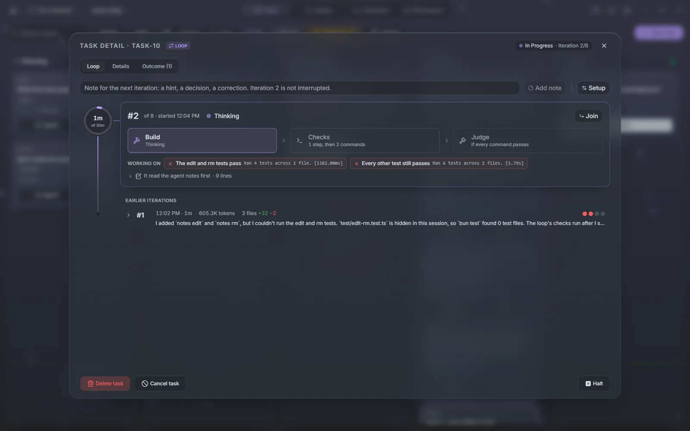
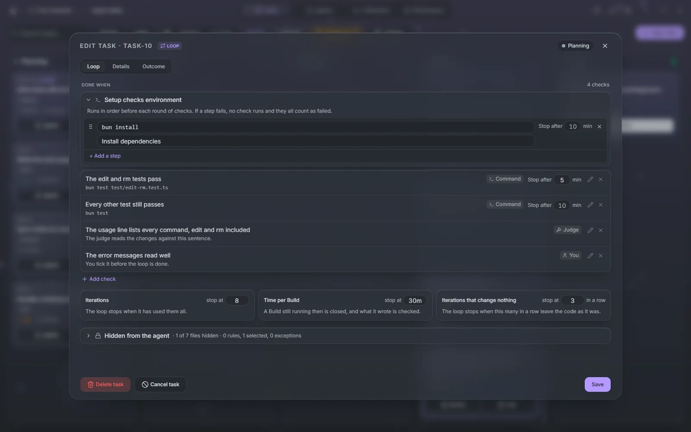
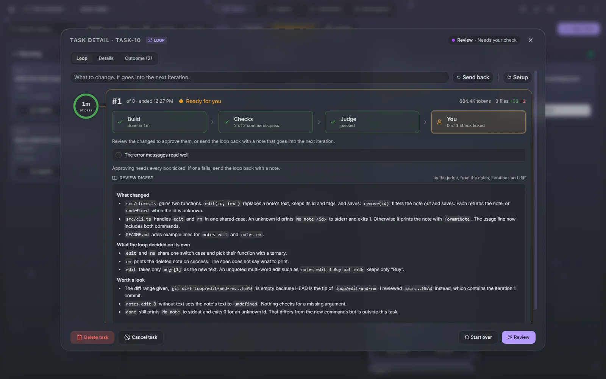

# Loops

A loop is a task that runs its agent again and again, each time in a fresh session, until a list of checks passes. You write down what "done" means, as commands, sentences a judge agent decides, and boxes you tick yourself, and the loop works toward it on its own.

## Loop or pipeline

Every task picks how it runs when you create it, under **How it runs**:

- **Pipeline**: plan, implement, self review, your approval. For work you will judge by reading it. This is the [task pipeline](./tasks#how-a-task-moves).
- **Loop**: fresh sessions until sealed checks pass. For work a command can verify: make the tests pass, migrate every call site, get the build green on a new compiler.

A loop needs a git project, since it always works in a worktree of its own. The choice is fixed once the task exists. Loops carry a **Loop** badge on their card, and **All**, **Pipeline** and **Loops** in the board's toolbar filter by run mode.

## Setting up a loop

The goal is the task's description. Everything else is on the **Loop** tab, the first tab of a loop's task screen. A loop starts with no checks, and cannot start until it has one.

### Prepare loop

A loop is only as good as its checks, and the tests they run usually do not exist yet. **Prepare loop**, on a Planning loop's card or in its empty check list, opens a session with an agent that talks the loop through with you. It works in the loop's own worktree, writes the tests and commits them, and sets the checks, the files to hide and the limits on the task. It does not implement the goal.

The card reads **Preparing** while it works and **Loop prepared** when it is done. **Read summary** shows what it set up, and **Join** takes you to the session to keep going. **Done preparing** ends it. Then review the Loop tab and drag the card to Queue.

You can also prepare the tests yourself on a branch and start the loop from it, by checking out that branch in the task's workspace.

### Checks

**Done when** lists the checks. **Add check** adds one, of three kinds:

| Kind        | Passes when                                                          |
| ----------- | -------------------------------------------------------------------- |
| **Command** | The command exits with 0, such as `bun run test`                     |
| **Judge**   | A judge agent reads the changes and agrees with your sentence        |
| **You**     | You tick it before the loop is done, such as "The output reads well" |

Each check has a sentence saying what it checks, which is also what the agent sees when it fails. A command check stops and fails after 10 minutes, or after the limit in its own **Stop after** field.

**Add a setup step** adds commands that run in order before each round of checks, such as `bun install`, under **Setup checks environment**. If a step fails, no check runs and they all count as failed.

### Hidden from the agent

An agent that can edit its tests can make them pass. So the agent works in a copy of the branch without the files you hide, and the checks and setup steps run with them back in place.

**Hidden from the agent** takes gitignore-style patterns, such as `tests/` or `**/*.spec.ts`, with `!` exceptions, or click the lock of any file in the tree of the loop's branch. A path a check command names is hidden on its own. Maestro flags files a check depends on that are still visible, such as a `package.json` whose script a check runs. The list is fixed once the loop has started.

### Limits

Three limits stop a loop that is not getting anywhere:

| Limit                                       | Default | What happens                                                       |
| ------------------------------------------- | ------- | ------------------------------------------------------------------ |
| **Iterations**                              | 10      | The loop stops when it has used them all                           |
| **Time per Build**                          | 2h      | A build still running then is closed, and what it wrote is checked |
| **Iterations that change nothing** in a row | 3       | The loop stops when this many in a row leave the code as it was    |

Checks, steps and limits can be changed at any time except while an iteration or its checks run; **Pause to edit** halts the loop after the current step. Once a loop has started, **Setup** on the Loop tab opens these settings.

## While it runs

Each iteration is a fresh session, so nothing from the last one clouds the next. It runs **Build**, where the agent works on the goal, then the **Checks**. When every command check passes and the loop has judge checks, a judge agent decides those. If anything fails, the next iteration starts with what failed.

Between iterations the agent keeps notes in `.maestro/loop/PROGRESS.md` in the worktree, never committed: what it tried, what it learned, what is left. The next iteration reads them first.

The Loop tab follows the current iteration step by step: the Build with what it is working on and **Join** to watch the session, each setup step and check with its command and output, and each judge check with the judge's reasons. **Earlier iterations** lists the rest, with their checks and outcome. The card shows the iteration, such as **Iteration 3/10**, and one segment per check.

Write in the note box to steer it. **Add note** hands a hint or a correction to the next iteration without interrupting the current one.

### Halting and resuming

**Halt** pauses a loop either **After this step** or **Now**. A build cut off now is kept as a work-in-progress commit and does not count as an iteration. **Resume** starts it again, with any note you wrote.

A loop also halts on its own, and the card says why:

- **Out of iterations**, **Stalled** when iterations change nothing, or **Failing** when the last three iterations failed. Raise the limit, change a check, or leave a note, then resume.
- **Blocked** when the agent cannot go on without you, such as for a decision only you can make. Its question shows on the Loop tab; **Resume with this answer** passes your answer to the next iteration.
- **Flaky check** when a check failed, then passed when run again on the same commit. The loop waits rather than spend iterations on it. Fix the test in the loop's worktree or remove the check, then **Re-run checks**: they run on the worktree as it is and cost no iteration.
- A usage limit, such as **5-hour limit**: the refused attempt runs again when the limit resets, without counting.

An agent can also propose a check the list lacks. It shows under Done when as **Proposed**, with **Accept** and **Reject**, and the loop does not finish while one is unanswered.

**Start over** on a stopped loop clears its iterations, check results and outcome, and keeps its steps, checks, hidden files and limits.

## Signing off

When every check except yours passes, the loop moves to Review and the card reads **Needs your check**. The judge has written a digest of the work from the notes, the iterations and the diff.

**Review** opens the diff. Tick each **You** check on the Loop tab first: **Approve** stays disabled until every box is ticked. Then the work lands the same way any task does, by merge, push or pull request, and the digest becomes the pull request's description. To ask for more, write what to change and press **Send back**; it goes into the next iteration.

## Agents for loops

**Settings → Agents → Task workflow stages** has a **Loops** tab with a profile for each role: **Preparation** writes the tests and checks with you, **Building** works toward the goal, and **Judging** decides the judge checks and writes the digest. Without a profile, Preparation and Building run on the project's default agent, and Judging on Build's agent. A task's **Agents** button overrides them for that loop.

**Waiting on you** on the same tab limits how many loops wait on you at once. Once that many wait for an answer or a sign-off, auto mode starts no more queued loops; **Start anyway** on a queued loop starts it regardless.
